# 连接 Android 手机

你需要一个已启用 CalDAV 扩展的 InKCre Python Peer、手机可以访问的 HTTPS 服务地址，
以及管理员设置的 DAV 专用密码。用户名固定为 `inkcre`。手机上安装 DAVx⁵ 和 Tasks.org，
由 DAVx⁵ 负责同步，日常操作在系统日历、Tasks.org 和联系人应用中完成。

本文截图来自华为 JKM-AL00a（Android 9）、DAVx⁵ 4.5.14-ose 和 Tasks.org 15.3。
全天事件的创建另用 [Etar 1.0.57](https://f-droid.org/packages/ws.xsoh.etar/) 验证。
截图中的账号和内容均为教程测试数据。preview 地址只在该 PR 的预览环境存续期间有效；
实际使用时填写自己的部署地址。

## 添加 DAVx⁵ 账户

打开 DAVx⁵，点击增加账户，选择「使用 URL 和用户名登录」，再点击「继续」。

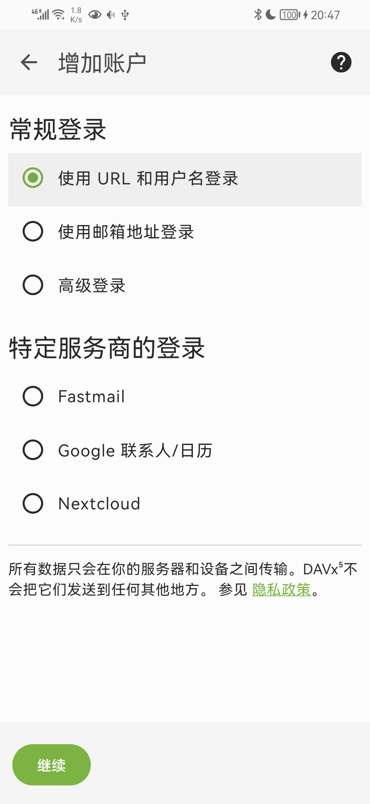

填写完整服务地址，例如 `https://你的部署域名/caldav/`，用户名填写 `inkcre`，
密码填写 DAV 专用密码。地址末尾包含 `/caldav/`；管理 InKCre 使用的 Peer JWT
不应填写到这里。点击登录后，按 DAVx⁵ 提示使用自己的邮箱作为账户显示名。
下面的 `preview146@example.invalid` 是本次测试专用名字。

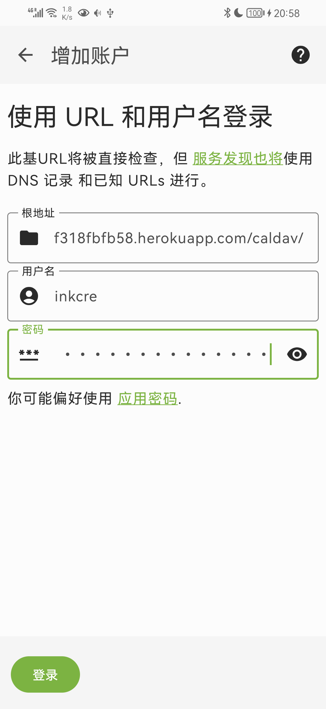
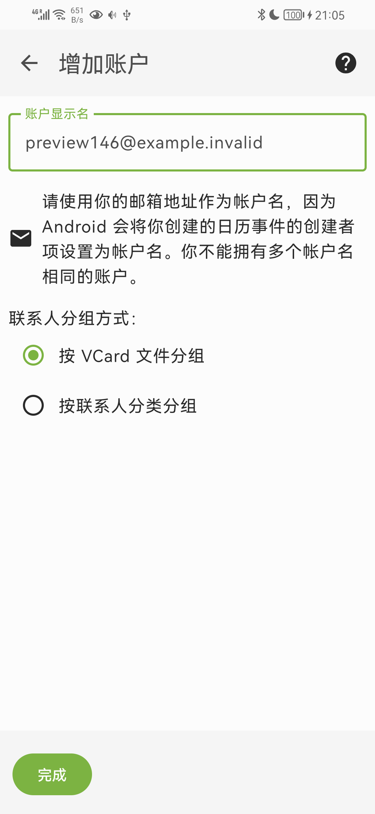

## 选择同步内容

在账户的 CalDAV 页勾选「InKCre 日历」和「InKCre 任务」，在 CardDAV 页勾选
「InKCre 联系人」。允许 DAVx⁵ 访问日历、联系人和 Tasks.org，然后点击「立即同步」。
首次同步会把远程集合注册到对应应用。

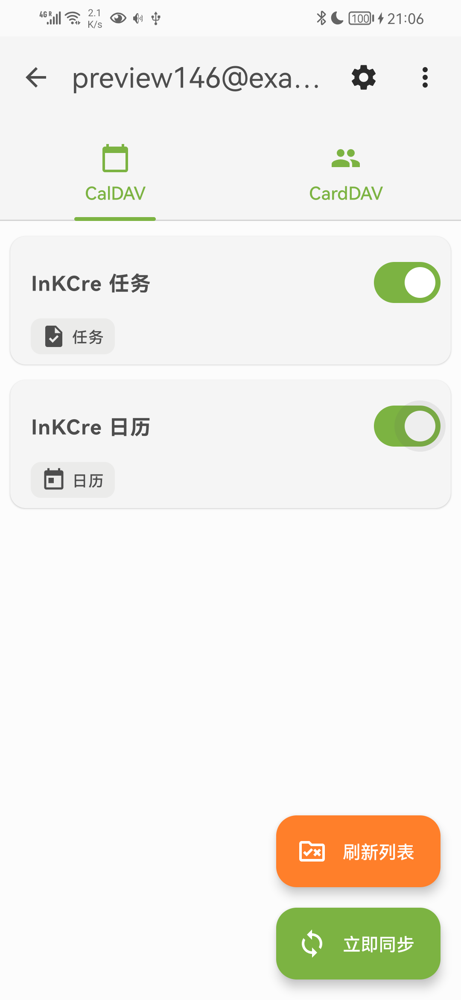
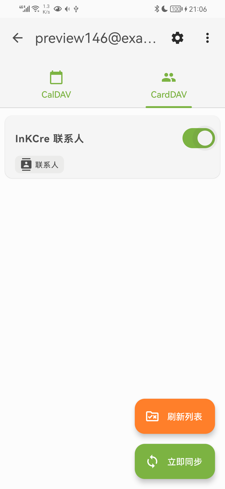

Tasks.org 的任务访问权限与 Android 日历权限不同。如果任务列表没有出现，
先检查 DAVx⁵ 是否取得 Tasks.org 的读写权限，再同步一次。后台自动同步还受手机
省电设置影响；可以先用「立即同步」确认连接，再按 DAVx⁵ 的提示设置后台运行。

## 使用日历、任务与联系人

在系统日历中创建事件时，将所属日历选为「InKCre 日历」。可以设置日期、时间、
重复规则和提醒；修改重复事件时，选择「此日程」可以只修改某一次。

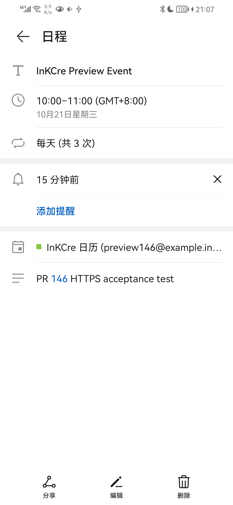
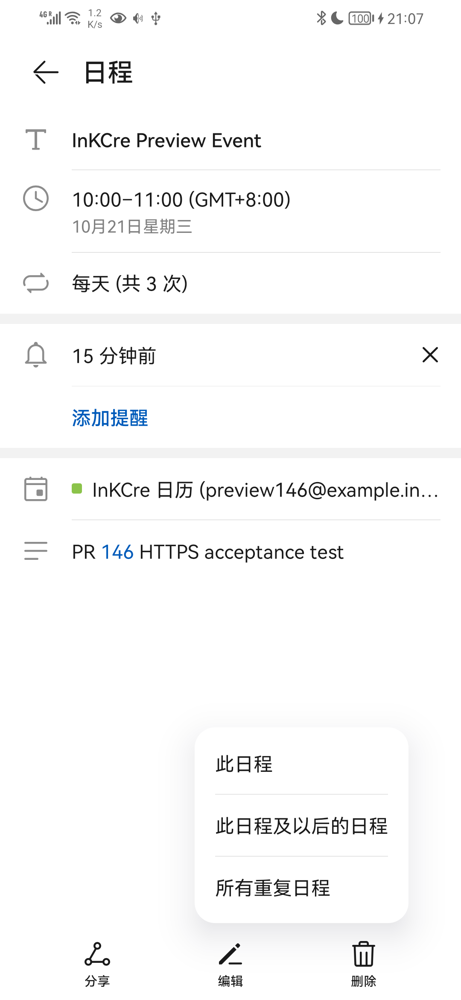

这台华为的系统日历在创建全天事件时会把 `eventTimezone` 写成
`java.util.SimpleTimeZone[...]`，导致 DAVx⁵ 在上传前报 `Invalid ID for region-based ZoneId`。
普通界面创建也能复现。遇到这个错误时，先在日历中删除尚未同步的测试事件，
再使用 Etar 创建；不要直接改数据库来掩盖客户端问题。Etar 中选择同一 InKCre 账户，
打开「全天」并保存即可。此限制来自本次真机观察，不代表其他华为型号或系统版本。

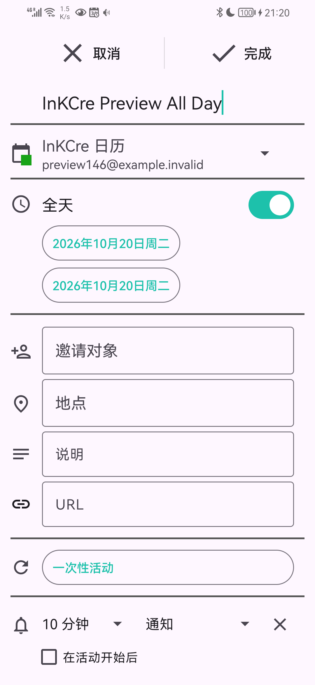

在 Tasks.org 中打开「InKCre 任务」列表，新增任务、设置到期时间、完成任务或添加子任务。
通过 DAVx⁵ 同步时，远程列表的创建、重命名和删除由 DAVx⁵ 的集合管理完成。
同一个服务只需配置这一个 DAVx⁵ 账户，避免再在 Tasks.org 中重复添加直接 CalDAV 账户。

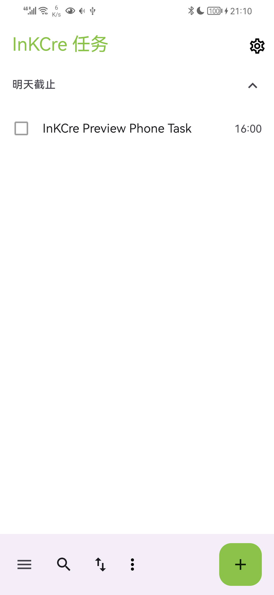
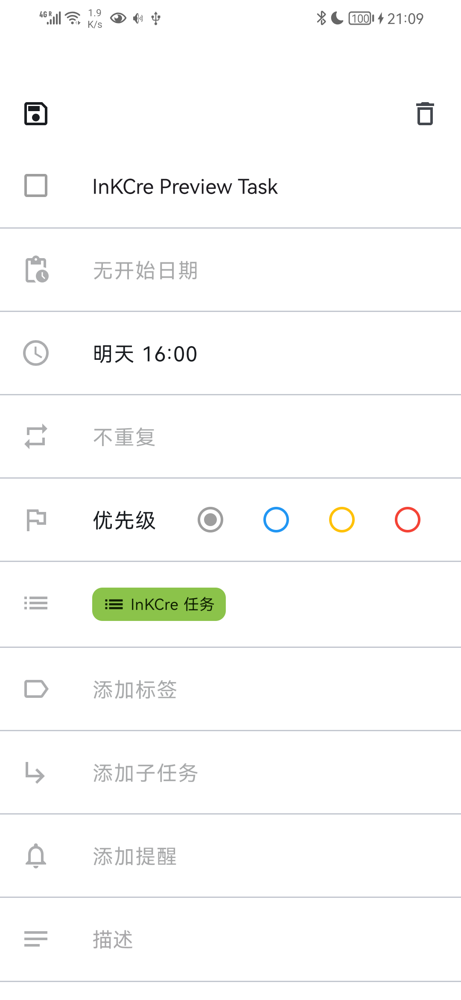
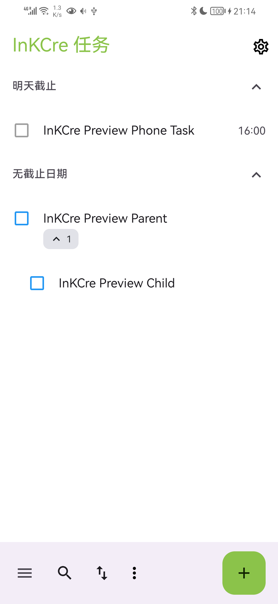

在系统联系人中新建联系人时，将保存位置选为 InKCre 对应的 DAVx⁵ 通讯录。
姓名、多个电话、邮箱、备注和照片都会随联系人同步。保存到「手机」或其他账户的联系人
不会因此自动迁入 InKCre。

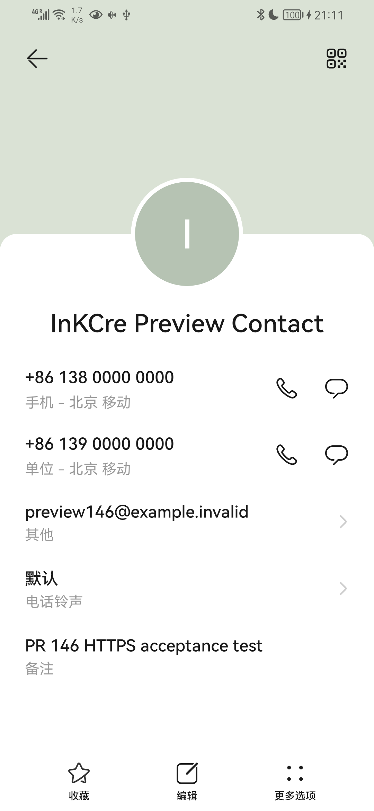

## 从信息库更新联系人

联系人中的电话、邮箱、备注和照片也是信息库中的独立内容。其他 Peer 修改共享电话或照片后，在 DAVx⁵ 点击「立即同步」，手机会取得这些变化。图中电话号码末尾的 `0146` 与绿色测试头像来自直接编辑共享电话 Block 和图片内容，并非重新导入联系人。

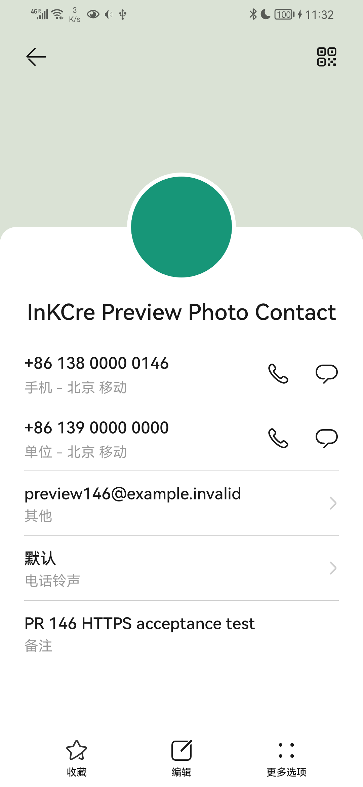

手机编辑并上传联系人时，相同内容继续关联原 Block；值发生变化时重新关联新内容。手机可能重新编码照片，这会产生新图片 Block，原图片及其他位置的引用仍然保留。Web 中打开独立内容的方法见 [CalDAV Web 教程](https://github.com/InKCre/impl-ts/blob/main/extensions/caldav/docs/module-federation/index.md)。

## 确认同步与处理连接问题

保存修改后，在 DAVx⁵ 点击「立即同步」，再从另一台使用同一服务的客户端查看修改结果。
离线期间可以继续编辑，恢复网络后再次同步。删除会撤销服务端的 DAV 发布，并从其他客户端移除对象；
信息库中的原对象、独立内容及已有引用仍保留。如果只是暂时不想同步，请取消勾选集合，避免执行删除集合。

在 Tasks.org 打开要删除的任务，点击删除并确认，再用 DAVx⁵ 立即同步。下面的专用测试任务删除后从手机列表消失；信息库中的任务根、描述和已有引用仍可读取。

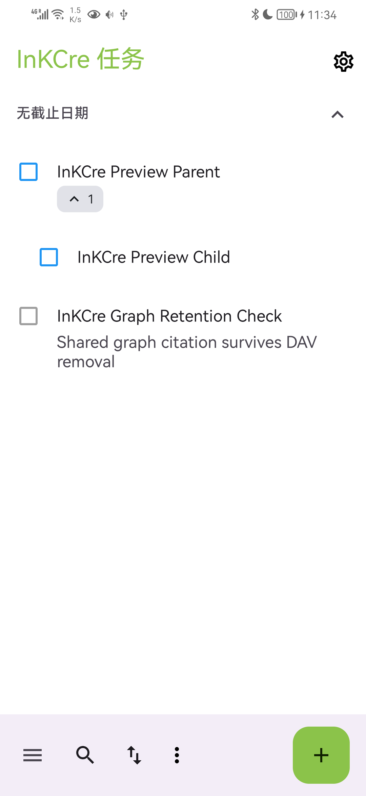
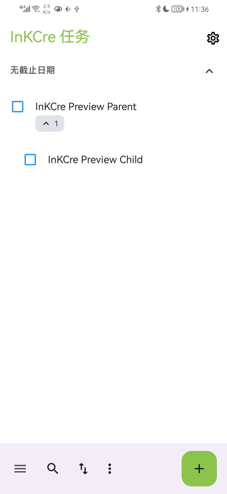

| 现象 | 检查 |
| --- | --- |
| 登录提示认证失败 | 用户名是否为 `inkcre`；密码是否为当前 DAV 专用密码；管理员是否撤销了密码 |
| 找不到集合 | 是否填写完整 `/caldav/` 地址；扩展是否正在目标 Peer 上运行 |
| 日历有数据但任务列表为空 | Tasks.org 是否已安装；DAVx⁵ 是否取得任务读写权限；任务集合是否已勾选 |
| 保存后其他客户端看不到 | 对象是否保存到了 InKCre 集合；DAVx⁵ 是否有同步错误；网络是否已经恢复 |
| 仅后台同步不及时 | 手机是否限制了 DAVx⁵ 的后台运行；手动同步是否成功 |

本次 preview 验收遇到手机网络将 Heroku 域名解析到错误地址的问题，使用 DAVx⁵ 的
HTTP 代理设置，经本机临时 CONNECT 隧道完成 HTTPS 连接。连接目标和证书仍是 preview；
代理没有终止 TLS。正常可访问部署的网络无需这一步。若出现连接超时，应先确认网络和
域名解析，而不是反复修改密码。

同一部署的 DAV 客户端共享全部 DAV 信息。需要撤销某个已泄露密码时，请管理员轮换
扩展密码，并在仍需访问的客户端更新密码。
