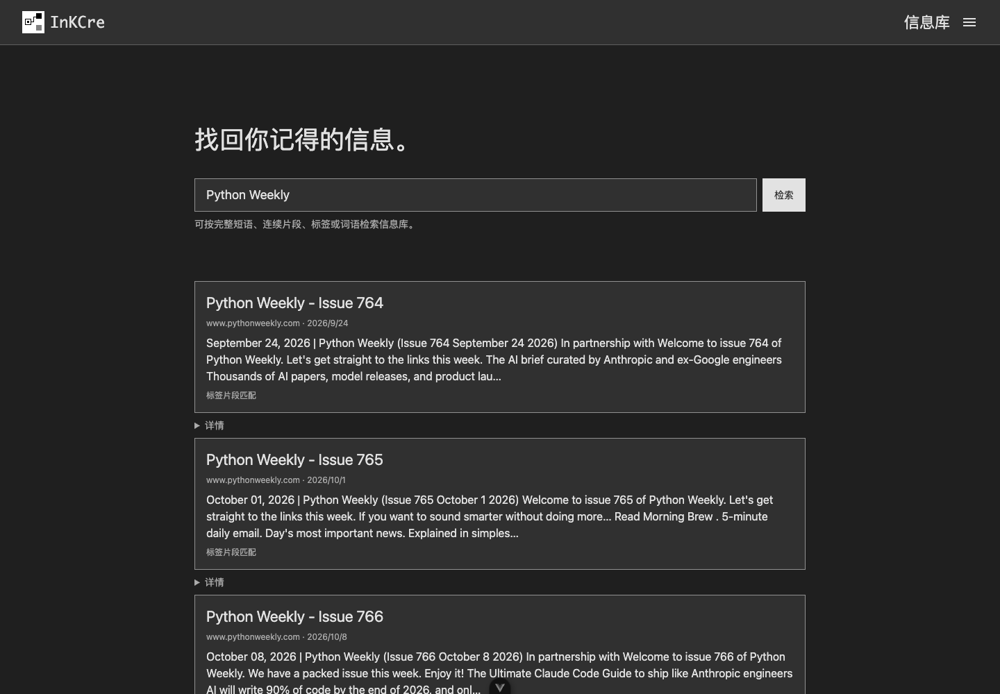
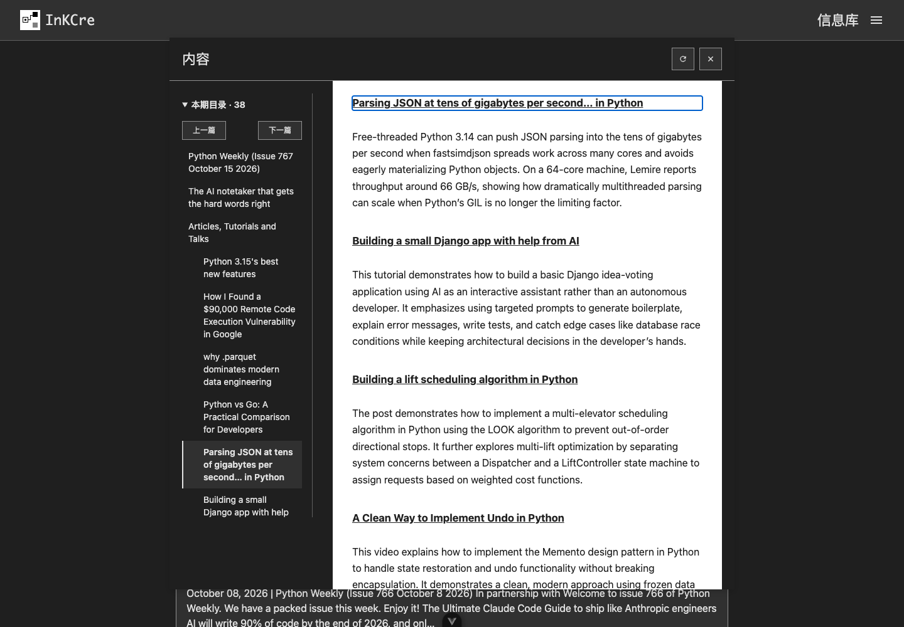
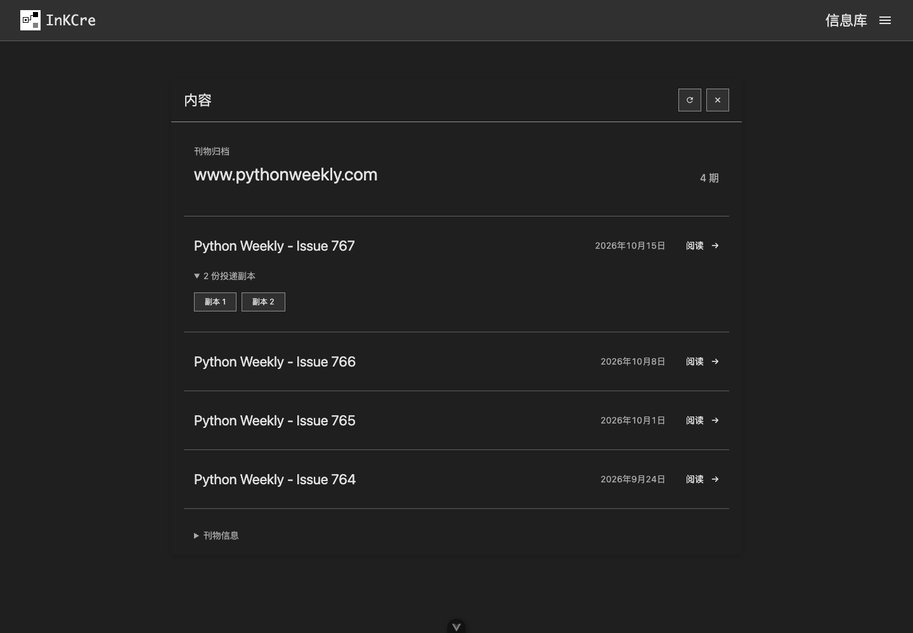

# Newsletter 阅读

Mail 通过 IMAP 把 newsletter 采集到 InKCre。你可以按刊物名或正文中的关键词搜索，打开清理后的正文阅读，再从刊物归档回看往期。

> **开发预览**：本页展示尚未发布的 newsletter 增强功能。截图来自 2026-10-20 至 2026-10-21 的桌面端实际验收，使用 Python
> Weekly 邮件；现有正式版本可能没有这些界面。采集端与网页端都需要配套更新。

## 搜索找到邮件

在搜索框输入刊物名，例如
`Python Weekly`，或输入记得的文章关键词。搜索结果把同封 newsletter 的邮件、HTML 正文和纯文本正文命中汇入一个阅读入口，摘要直接展示正文文字。打开结果即可阅读；展开详情仍可查看各条原始命中。

独立投递的邮件副本仍保留各自的搜索入口。刊物归档会将同一期的副本折叠展示。

## 按目录阅读长邮件

桌面阅读页左侧显示文章目录。点击标题跳到对应位置，也可使用上一篇、下一篇按钮移动。目录在阅读时保持可见，正文使用同一层滚动；不必在整封长邮件中反复拖动查找文章。

重新打开同一篇正文时，可以继续上次阅读。位置只保存在当前浏览器中，不跨设备同步。窄窗口默认收起目录，需要时再展开。

阅读视图保留文章标题、正文和有效链接，移除隐藏预览文字、跟踪像素及明确的订阅操作链接。文章链接仍可主动打开；无法确认用途的跳转链接会保留。两种视图都不会自动加载外部图片。需要核对原始邮件时，点击
**查看原文**。

## 回看同一刊物的各期

在邮件顶部点击刊物名称旁的
**查看各期**，打开刊物归档。各期按发布时间倒序排列，点击标题所在行即可阅读。同一期收到多个副本时，展开副本列表可分别打开；刊物标识可在底部的
**刊物信息** 中查看。

归档依据邮件中的刊物声明建立，不会只凭相同主题或发件人把邮件归为同刊。当前支持有效的
`List-ID`，以及 Beehiiv 明确声明的 newsletter 刊物身份。缺少这些声明的邮件仍按普通邮件处理。

## 已有邮件如何获得新视图

升级前采集的邮件，需要对相应日期范围执行历史采集（backfill），补齐刊物归属和阅读正文。历史采集默认不把邮件标记为已读。已有搜索索引还需要显式重建词法索引，才会使用清理后的摘要。这些操作保留原始正文；阅读视图也不会替你退订刊物。
