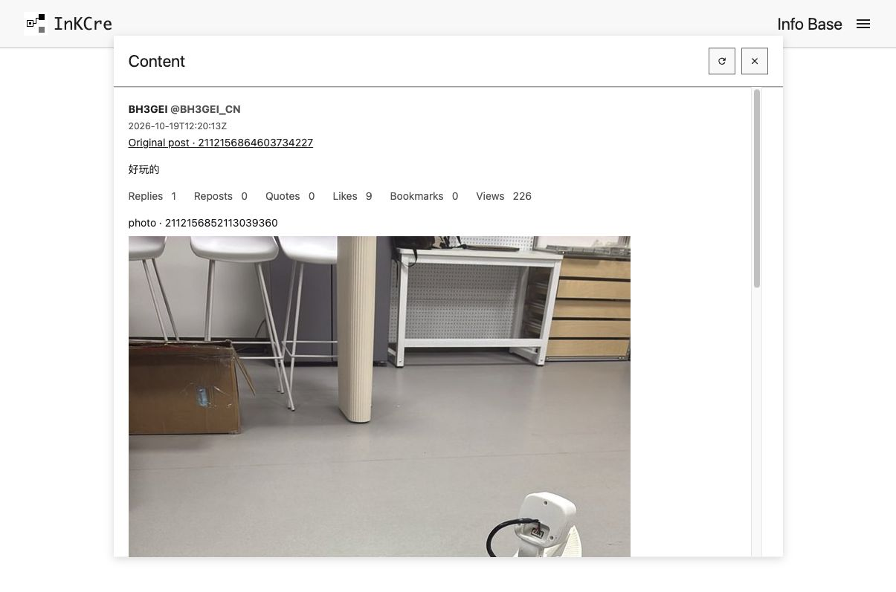

# 检索、阅读与媒体

[x-monkey](./x-monkey.md) 与 [Bookmark](./bookmarks.md)
保存的信息都可从 InKCre 独立使用。关闭脚本、断开提交会话或停止采集计划，不会删除已经写入 info-base 的记录。Web 需要能够解释当前 Twitter 记录的兼容分发。

## 保存后找回同一帖子

1. 先确认脚本的逐项同步结果，或 Bookmark 采集 Job 的实际完成状态。
2. 按既有[索引与搜索流程](https://inkcre.dev/guide/search)维护词法索引，等待维护完成。提交和采集不会隐式维护索引，不需要为了这条检索路径配置 AI 凭据。
3. 用原帖 ID、原始链接、作者或正文线索搜索，在 Info Base 打开结果。检查正文、长文和 **Original
   post** 出处；已捕获的作者及引用、回复、转帖上下文可以继续导航。

只知道原生 ID 的引用会显示为未捕获的身份，不伪造正文或作者资料。纯转帖也不补出一段假正文。旧 v1 帖子仍保留读取能力；重新采集到足够原生事实后可沿用原 Block
ID 升级，既有用户引用继续有效。历史上已经存在的重复不会在本版本全量清理。

## 媒体按需读取

图片、视频或 GIF 初始只显示已经捕获的元数据。需要查看时点击 **Load
media**；Twitter 阅读分发才从已捕获的 CDN URL 经 HTTP
Storage 读取字节。保存、query、列表、正文投影与索引不会提前下载这些原生媒体。

这是隔离预览中真实保存的同一帖子，照片在用户明确加载后显示。本版本不预建持久媒体内容 Block，不转存媒体文件，也不创建媒体下载 Job；**Load
media** 不会将字节保存在信息库。

读取只接受允许 CDN 主机的 HTTPS 地址。视频和 GIF 从已捕获的可用 MP4
variants 中选择最高码率，不把 HLS 播放清单当作视频本体。原生 URL 和其他元数据仍保留，即使它们不能用于当前读取。

## 来源失效或内容不完整时

源站 URL 失效、超时、体积超限或没有可用地址时，界面会反馈媒体不可用；文字和元数据仍可读取。重新打开内容不代表媒体已经长期保全，不应把“已同步”理解为文件备份成功。

阅读只解释已经保存的内容，不额外抓取未捕获的完整线程、引用正文或历史。x-monkey 与 Bookmark 的源信息密度不同，后来的稀疏信息不会抹掉未提交的已知内容；计数按各项实际观察时间合并，较旧观察不会覆盖较新值。

返回[扩展概览](./index.md)。
