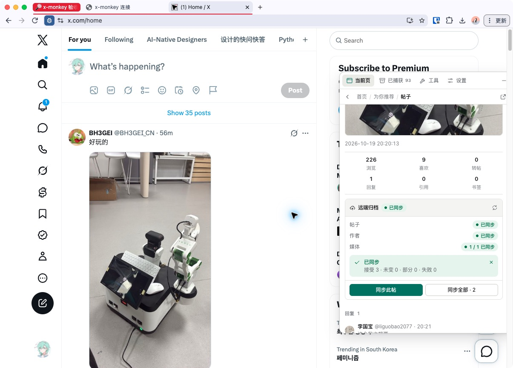

# 用 x-monkey 保存帖子

此入口接收原版 [x-monkey](https://github.com/steven-vvv/x-monkey)
捕获的帖子、作者和媒体元数据，不需要 X OAuth 应用、Bookmark Source 或采集计划。兼容基线为 x-monkey
`v0.2.0`。

## 连接自己的 InKCre

准备已连接自己 info-base 的 InKCre
Web、可从浏览器访问的 Core 公共 HTTPS 地址，以及正在使用的原版 x-monkey 脚本。在 Core 和 **This
browser** 分别安装、启用兼容的 Twitter 分发。

1. 在 InKCre Web 的 **Extensions** 中打开 Twitter 的 **Setup**，选择连接同一 info-base 的在线 Core
   Peer。
2. 找到 **Connect x-monkey storage**，复制其中的 **x-monkey service address**，再点击 **Connect
   x-monkey**。浏览器将导航到所选 Core 的账户页；发起跳转后仍需确认账户页和脚本检测结果。
3. 浏览器进入该 Core 的账户页，确认已连接的 Peer 和会话到期时间。这一步使用现有 InKCre 连接建立会话，不需要把
   `JWT_SECRET` 交给脚本或 X。
4. 返回 x-monkey，打开 **设置 → 远端数据库**，启用远端数据库，将刚才的服务地址填入
   **服务地址**，保存并点击
   **检测**。确认已连接，再开始同步。地址必须保留 Setup 显示的完整路径前缀。

如果脚本先显示“需要登录”，可点击“打开账户页”查看连接指引，再从已连接的 InKCre
Web 完成上述操作，最后回到脚本重新检测。账户页不自动查找你的 InKCre
Web 地址。Setup 没有连接按钮、只有服务地址，或无法发起跳转时，检查所选 Core 是否在线并提供连接能力，以及两端分发和宿主版本是否兼容。

## 同步已捕获的帖子

在 X 打开帖子，让 x-monkey 捕获它，再在脚本中打开该帖详情。找到 **远端归档**，点击
**同步此帖**，检查帖子、作者及媒体的逐项结果。**同步全部**也可能包含已经捕获的上下文；它不会让 InKCre 补抓尚未捕获的完整线程或历史。

图中是预览环境的真实同步结果，记录数量取决于脚本捕获的内容。“媒体已同步”表示媒体元数据已保存，不表示图片或视频文件已经转存。

再次同步同一原生帖子会补充同一个信息根，保留未提交的已知字段，并按计数观察时间合并更新。Bookmark 采集到同一帖子时也补充这份信息。较旧捕获可能继续显示计数差异；不能仅凭差异判断保存失败。

保存后，按[检索与阅读](./reading.md)找回同一帖子。关闭脚本或结束提交会话后，已保存的信息仍在。

## 续签、过期与断开

此会话具有现有 Peer
JWT 的完整信息库访问权限，默认有效期为 7 天。有效的会话检测、查询和提交请求在剩余期限不超过当前配置寿命的一半时自动续签。部署者可以调整签发期限；普通 Core 请求不会续签该会话。

过期后需重新从 InKCre Web 连接，不需要额外的 refresh
token。活跃会话没有从首次连接开始计算的绝对续签上限。账户页的断开操作只清除此浏览器的会话，不删除已保存信息，也不撤销已经复制的 JWT。

## 检测或同步失败时

- **需要登录 / 401**：从 InKCre
  Web 重新连接，然后返回脚本检测。不要把 Core 的 JWT_SECRET 填入脚本来代替连接流程。
- **账户页或协议返回 404**：检查服务地址、部署路径前缀，以及 Twitter 是否正在所选 Core 上运行。
- **结果失败或请求超时**：保留捕获内容，检查实际请求结果再重试。成功保存后重复提交仍补充同一帖子，不必创建第二个存储后端。
- **媒体读取失败**：按[媒体边界](./reading.md#媒体按需读取)处理；元数据同步成功不保证外部媒体 URL 长期可用。

返回[扩展概览](./index.md)，或继续配置独立的 [Bookmark 采集](./bookmarks.md)。
